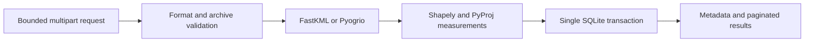

# Geospatial File Measurement API

A FastAPI backend for the Aereo software development internship assignment. Upload KML or a zipped Shapefile, inspect its features, and retrieve polygon areas and line lengths calculated in a suitable local projected coordinate system.

**Stack:** Python 3.12, FastAPI, SQLAlchemy/SQLite, FastKML, Pyogrio/GDAL, Shapely and PyProj. Each supported feature is measured in local WGS84 UTM, in metres or square metres; source geometry and CRS are retained.

**Required endpoints:** `POST /api/files/`, `GET /api/files/{id}/`, and `GET /api/files/{id}/measurements/`.

**Reviewer shortcut:** after installing the development dependencies, run `python scripts/reviewer_demo.py`. It starts and cleans up an isolated service, exercises both formats and retrieval endpoints, verifies 200 m², and demonstrates a safe rejection. No existing database is used. UUIDs, timestamps and the local port vary; the checked behaviors do not.

**Measurement proof:** [executed evidence](docs/MEASUREMENT_EVIDENCE.md) records 16 cases with actual results, independent references, model differences and acceptance criteria. Recompute with `python scripts/measurement_evidence.py --check`.

**Start with:** [official brief notes](docs/OFFICIAL_ASSIGNMENT.md), [requirements matrix](docs/REQUIREMENTS.md), [technical decisions](docs/TECHNICAL_DECISIONS.md), and [delivery report](docs/DELIVERY_REPORT.md).

## Quick start

Use **Python 3.12** (tested with **3.12.13**) and a platform with binary wheels for the pinned GIS libraries. No separate database server or system GDAL installation is needed on the tested platform.

From the repository directory:

```bash
python3.12 -m venv .venv
source .venv/bin/activate
python -m pip install --upgrade pip==26.2.1
python -m pip install --only-binary=:all: -r requirements-dev.lock
python -m pip check
uvicorn app.main:create_app --factory --host 127.0.0.1 --port 8000 --limit-concurrency 8
```

For the isolated HTTP demo, run `python scripts/reviewer_demo.py` instead of starting Uvicorn. Run tests with `pytest --cov=app --cov-report=term-missing --cov-fail-under=85`.

For runtime only, install `requirements.lock` instead. Both lockfiles pin the dependency closure; `pyproject.toml` pins direct runtime dependencies. The service runs from source, so an editable install is optional (`python -m pip install --no-deps -e .`). Lockfiles pin versions rather than artifact hashes. The Python base-image tag is pinned by version, not digest.

Open [Swagger UI](http://127.0.0.1:8000/docs) or [OpenAPI JSON](http://127.0.0.1:8000/openapi.json). Health: `GET /health`, which checks database access.

Configuration comes from environment variables. `.env.example` lists defaults; the service does **not** load `.env` implicitly. For example, before startup:

```bash
export AEREO_DATABASE_URL=sqlite:///./data/aereo.db
export AEREO_MAX_UPLOAD_BYTES=10485760
```

SQLite is the supported database. The parent directory is created automatically. Keep the database and its WAL files in durable storage when restarting; do not copy a live database file alone as a backup.

## What works

- All three specified endpoints; interactive Swagger documentation.
- KML 2.2 and a ZIP containing one Shapefile dataset, including nested directories and case-insensitive companion extensions.
- Source feature IDs, attributes, geometry and CRS preserved in paginated results.
- Polygon/MultiPolygon area, including holes; LineString/MultiLineString length.
- Per-feature projected CRS, measurement units, status, and reasons for skipped measurements.
- SQLite persistence across restarts, atomic writes, and temporary-file cleanup.
- Bounded multipart bodies, ZIP defenses, entity-safe KML validation, and safe error responses.
- Analytic and independent geodesic-reference tests, real file integration tests, adversarial regression tests, lint, typing, Docker configuration and CI.

**Scope:** this is a local evaluation service for bounded survey-like features. It is unauthenticated. Measurements are planar 2D approximations; broad, polar, and antimeridian-crossing features are retained with an explicit unsupported status. See the projection policy below before interpreting results.

## Docker

With Docker Engine and the Compose plugin running:

```bash
docker compose up --build -d
curl --fail http://127.0.0.1:8000/health
docker compose logs api
docker compose down
```

The named volume preserves results across container replacement. Compose binds to loopback, uses an unprivileged user, drops capabilities, sets resource limits, mounts the root filesystem read-only, and provides bounded temporary space. `down` retains the named volume; do not use `down -v` unless deleting the stored results is intended.

**Verification limitation:** Docker could not be built/run on the development host because its daemon was unavailable and its Compose plugin was absent. CI includes image build and container smoke steps, but a hosted CI run still requires publication. Native Python startup and HTTP sample tests did run successfully; see the delivery report.

## API contract

The brief specifies endpoint paths and example metadata, but leaves units, identifier format, errors, pagination and HTTP success status to implementation. These choices are documented here.

| Method | Path | Behavior |
|---|---|---|
| POST | `/api/files/` | Exactly one multipart `file`; validates, processes and persists synchronously; `201` on success |
| GET | `/api/files/{id}/` | Metadata for UUID `{id}`; `200`, or `404` if absent |
| GET | `/api/files/{id}/measurements/` | Feature results; `offset=0`, `limit=100` by default; maximum limit `500` |
| GET | `/health` | Process/database readiness check |

### Upload

```bash
curl --fail-with-body -F 'file=@sample_data/bengaluru.kml' \
  http://127.0.0.1:8000/api/files/

curl --fail-with-body -F 'file=@sample_data/reference_rectangle.zip' \
  http://127.0.0.1:8000/api/files/
```

The response contains these fields (UUID, timestamp and hash vary with upload):

```json
{
  "id": "c8dff077-b648-4be5-a7db-20f417db47b6",
  "filename": "bengaluru.kml",
  "format": "kml",
  "feature_count": 3,
  "crs": "EPSG:4326",
  "status": "COMPLETED",
  "uploaded_at": "2026-10-11T00:00:00Z",
  "sha256": "<64 hexadecimal characters>",
  "measured_count": 2,
  "skipped_count": 1
}
```

This metadata example is schematic; the measured sample output below was observed in the real HTTP smoke test. `COMPLETED` means the pipeline finished, including explicit skipped-feature results. It does not promise that every feature was measured. A malformed file fails before any record is committed.

### Retrieve

Set `FILE_ID` to the UUID returned by your upload:

```bash
FILE_ID='c8dff077-b648-4be5-a7db-20f417db47b6'
curl --fail-with-body "http://127.0.0.1:8000/api/files/$FILE_ID/"
curl --fail-with-body "http://127.0.0.1:8000/api/files/$FILE_ID/measurements/?offset=0&limit=100"
```

The measurement envelope contains `file_id`, `total`, `offset`, `limit`, and `features`. A feature includes:

```json
{
  "feature_id": "parcel",
  "index": 0,
  "geometry_type": "Polygon",
  "geometry": {
    "type": "Polygon",
    "coordinates": [[[77.59,12.97],[77.591,12.97],[77.591,12.971],[77.59,12.971],[77.59,12.97]]]
  },
  "properties": {"name":"Example parcel","extended_data":{"purpose":"Assignment demonstration"}},
  "crs": "EPSG:4326",
  "status": "MEASURED",
  "reason": null,
  "area_m2": 12016.970249021719,
  "length_m": null,
  "measurement_crs": "EPSG:32643",
  "method": "planar_local_utm",
  "warnings": []
}
```

`geometry` remains in its **source CRS**. Its object structure resembles GeoJSON; projected source coordinates are **not RFC 7946 longitude/latitude GeoJSON**. `index` is a unique zero-based position within an upload; source IDs may repeat. Nonfinite, absent or empty geometries are represented with `geometry: null` and a reason.

| Feature status | Meaning |
|---|---|
| `MEASURED` | Area or length calculated |
| `NO_MEASUREMENT` | Point/MultiPoint; neither measurement is applicable |
| `NULL_GEOMETRY` / `EMPTY_GEOMETRY` | No usable geometry |
| `INVALID_GEOMETRY` | Invalid topology or coordinates; not repaired |
| `UNSUPPORTED_GEOMETRY` | Mixed collection retained without a measurement |
| `OUTSIDE_SUPPORTED_EXTENT` | Outside the documented projection policy |
| `TRANSFORMATION_FAILED` | A reliable transformation is unavailable |

### Errors

```json
{"error":{"code":"MISSING_CRS","message":"Shapefile requires a matching .prj file."}}
```

| HTTP status | Examples |
|---|---|
| 400 | Malformed multipart/HTTP request |
| 404 | Valid UUID does not identify a stored file |
| 413 | Upload, archive, XML, feature, or coordinate limit exceeded |
| 415 | Unsupported filename extension |
| 422 | Missing field, invalid UUID/page parameters, corrupt data, unsafe ZIP, missing companions/CRS |
| 500 | Unexpected processing/storage failure; internal details logged, not returned |

The server command's concurrency limit can reject overloaded requests with Uvicorn's own `503` response before the application handles them. Its body is outside the application's JSON error contract.

## Format and measurement policies

**Shapefile ZIP:** one `.shp`, matching `.shx`, `.dbf`, and `.prj`; optional `.cpg`. Case-insensitive paths and ordinary subdirectories work. Multiple datasets, missing/invalid CRS, encrypted ZIPs, unsafe paths, symlinks, duplicate normalized paths and nested archives are rejected. Stored and DEFLATE compression are accepted. Extra sidecars are validated/read for limits and CRC but not passed to GDAL; unrelated files are not extracted.

**KML:** KML 2.2 namespace, Placemark features within Document/Folder, regular geometry and MultiGeometry. IDs, common descriptive fields, Data and SimpleData values are retained. Styles, overlays, custom metadata vocabularies and full KML round-trip fidelity are not provided. NetworkLink, Model and gx tracks are rejected. Rings must explicitly close; multiple geometries must use MultiGeometry. Duplicate singleton geometry children (including outer boundaries and coordinate blocks) are rejected before FastKML can discard them. Malformed structural geometry rejects the file; parseable invalid topology produces a skipped-feature result.

**CRS:** longitude/latitude are angles, not metres. For every measurable feature, transform its geometry to WGS84 to inspect extent, then select WGS84 UTM using its bounds midpoint. Require extent ≤1° longitude and latitude and latitude between 80°S and 84°N. Transform the original geometry into that metric CRS with `always_xy=True`, disabled ballpark transformations, and offline PROJ. Both projected and geographic source files follow this policy; feet-based source coordinates are transformed correctly.

UTM introduces scale distortion and is not equal-area. This service reports 2D planar measurements of the supplied vertices; it does not densify edges or calculate ellipsoidal, terrain-following or sloped-surface measurements. Holes subtract area; multipart components sum. Per-feature CRS selection allows separate local features in distant locations in one dataset. Broad multipart extents are intentionally skipped. No silent geometry repair or broad-area fallback is applied.

Default limits:

| Resource | Limit |
|---|---|
| File upload | 10 MiB |
| Complete HTTP body | File limit + 64 KiB multipart overhead |
| ZIP expanded bytes | 50 MiB |
| ZIP entries / compression ratio | 128 / 100:1 per member |
| Features / coordinates per file | 5,000 / 200,000 |
| XML elements / depth | 100,000 / 32 |

Limits bound accepted inputs, not all intermediate native-parser allocations. Use the supplied concurrency limit; publicly exposed workloads would require stronger worker isolation, authentication, quotas and retention.

## Architecture



| Component | Responsibility |
|---|---|
| `app/main.py`, `schemas.py`, `errors.py` | HTTP contract, validation and safe errors |
| `app/middleware.py`, `config.py` | Request-body bounds and configuration |
| `app/services/archive.py`, `parsing.py` | Safe extraction and established format readers |
| `app/services/measurement.py` | Geometry validation, projection selection, measurements |
| `app/services/files.py` | Ingestion and atomic result persistence |
| `app/db.py` | SQLite models and sessions |

Results are calculated once, then read from SQLite. Original upload bytes are discarded. Geometry is stored once per feature because inspection is required. No Redis, worker queue, PostGIS, authentication service or frontend is required for the local assignment.

## Verification and sample data

With the development lockfile installed:

```bash
ruff check .
ruff format --check .
mypy app
pytest --cov=app --cov-report=term-missing --cov-fail-under=85
python scripts/measurement_evidence.py --check
python scripts/reviewer_demo.py
pip-audit -r requirements-dev.lock --no-deps --disable-pip
```

`scripts/reviewer_demo.py` performs the complete HTTP demonstration; `scripts/smoke.py` remains a compatibility alias. Both use a temporary database, ignore inherited Aereo configuration, verify retrieval and safe rejection, and stop the server even if a check fails. Tests create actual GIS files and use real parsing/transformation code. The bundled datasets are synthetic examples generated by `python scripts/generate_samples.py`; they are not private or company data.

- Analytic tests: rectangles, holes, multipart area, 3–4–5 lines, and feet conversion.
- Five deterministic Hypothesis properties exercise ring/line reversal, same-CRS area additivity, and feature-order independence through HTTP. The executed run accepted 40 generated examples per property; these complement fixed numeric references.
- Geographic tests: independent `Geod` references, both hemispheres and zone boundaries. Comparison tolerances are 0.2% for length and 0.4% for area on these local fixtures, accounting for projection distortion; they are not a universal accuracy guarantee.
- Integration tests: both formats, attribute preservation, pagination, restart persistence, concurrent/repeated uploads, OpenAPI, safe errors and atomic rollback.
- Adversarial tests: archives, KML entities, corrupt native-parser inputs, limits and temporary cleanup.

Actual commands, results and environmental limitations are recorded in [DELIVERY_REPORT.md](docs/DELIVERY_REPORT.md). GitHub Actions performs lint, typing, tests, vulnerability audit and Docker verification after the project is published.

## Learning, tradeoffs, and future scope

The central learning is that a plausible number is not necessarily a valid measurement: source units, axis order, datum transformation, projection distortion, geometry validity and edge interpretation all matter. The candidate should understand why this service refuses some inputs, why point measurements are null, and why a completed upload can contain skipped features. [Interview preparation](docs/INTERVIEW_PREP.md) contains ten foundation questions and five deeper follow-ups to work through against the code.

FastAPI keeps API contracts visible; SQLite keeps evaluation reproducible; direct Pyogrio avoids adding a dataframe dependency solely for reading features. Synchronous processing is appropriate for these bounded inputs and keeps transaction semantics simple. These are design choices, not claims about measured scalability.

Known limitations include bounded geographic coverage, partial KML metadata fidelity, offline datum grids, no raw-file download, no ownership/authentication, no delete/retention API, no durable background jobs, no schema migrations, and no process-level parser timeout. Future improvements should start with isolated workers and retention, then a separately tested global geodesic/equal-area policy if required. Add PostGIS or queues only when actual spatial queries or workload demands justify them.

## Submission

1. Review the [requirements matrix](docs/REQUIREMENTS.md) and [delivery report](docs/DELIVERY_REPORT.md).
2. Run Docker verification on a host with a working daemon.
3. Create a public GitHub repository containing this directory's contents, preserving `.github/` and the samples.
4. Verify hosted CI and confirm that a fresh clone installs and runs, then submit its URL with the requested candidate details.

No GitHub repository has been published and no application form has been submitted by this build.
